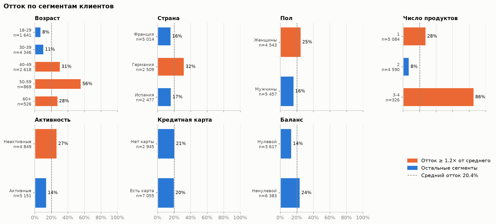
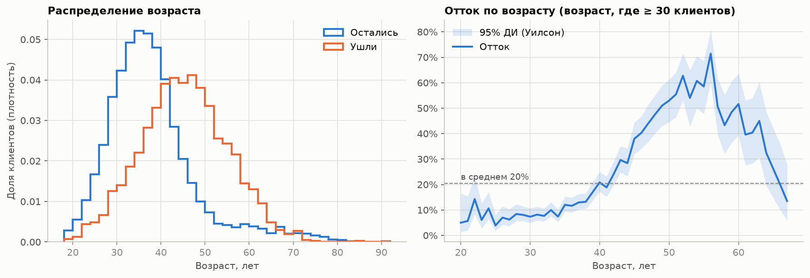
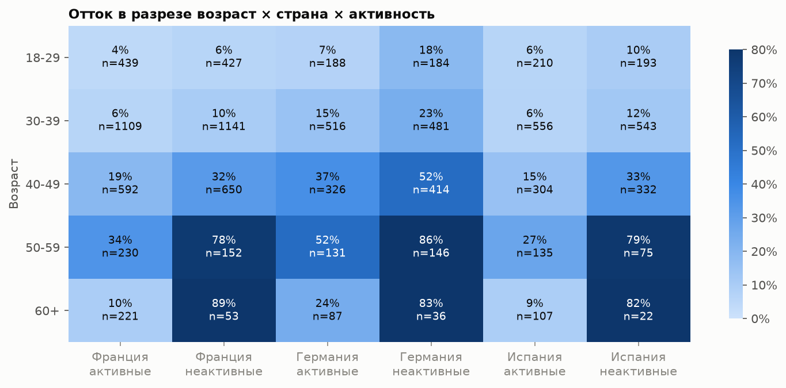
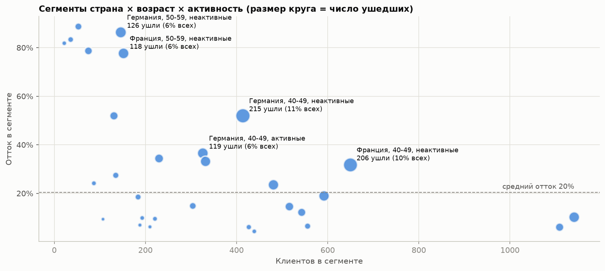
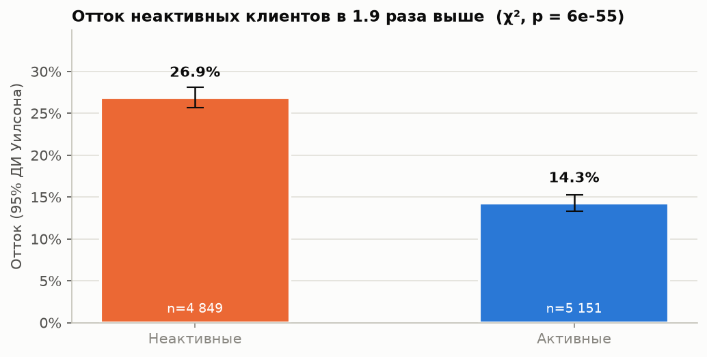
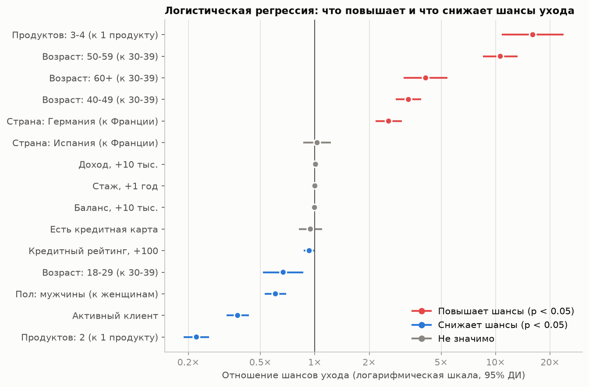
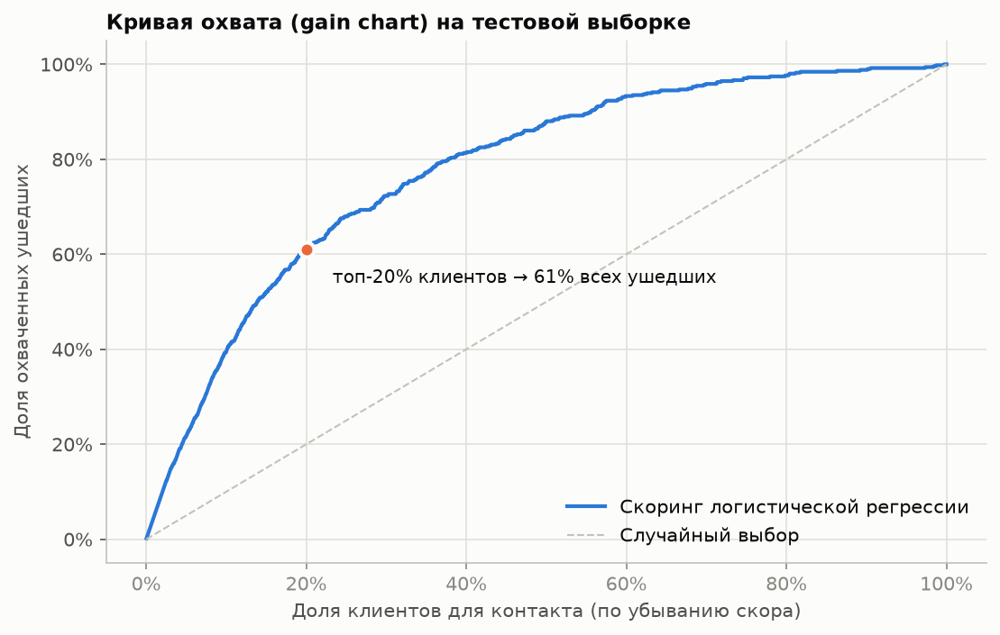

# Анализ оттока клиентов банка

Учебный проект по продуктовой аналитике: на открытых данных 10 000 клиентов банка
определяется, кто и почему уходит, предлагаются меры удержания и дизайн A/B-теста для
проверки их эффекта.

> **Главный вывод.** Неактивные клиенты уходят в **1.9 раза** чаще активных
> (27% против 14%, χ², p < 0.001). Неактивные клиенты **от 40 лет** — это 19% базы,
> но на них приходится **46% всех ушедших** — приоритетный сегмент для удержания.



---

## Задача

Банк теряет каждого пятого клиента. Нужно ответить на три вопроса:

1. Какие сегменты клиентов уходят чаще всего?
2. Какие различия статистически значимы, а какие могут быть случайными?
3. На ком сосредоточить удержание и как проверить, что мера работает?

## Данные

- [Bank Customer Churn](https://www.kaggle.com/datasets/radheshyamkollipara/bank-customer-churn)
  (Kaggle), файл `data/raw/Customer-Churn-Records.csv`. Это расширенная версия
  классического `Churn_Modelling.csv`.
- 10 000 клиентов, 18 столбцов: страна, пол, возраст, стаж, баланс, число продуктов,
  наличие кредитной карты, активность, доход, кредитный рейтинг, а также `Complain`,
  `Satisfaction Score`, `Card Type`, `Point Earned`.
- Целевая переменная — `Exited` (1 = клиент ушёл). Средний отток — **20.4%**.
- Пропусков и дублей нет. Значения проверены на допустимые границы через `assert`.

## Ключевые выводы

| Сегмент | Отток | Сравнение |
|---|---|---|
| Все клиенты | 20.4% | — |
| Неактивные / активные | 26.9% / 14.3% | в 1.9 раза выше; разница 12.6 п.п. (95% ДИ 11.0–14.2) |
| Возраст 50–59 / 30–39 | 56.0% / 10.9% | в 5 раз выше |
| Германия / Франция | 32.4% / 16.2% | в 2 раза выше |
| 1 / 2 / 3–4 продукта | 27.7% / 7.6% / 85.9% | U-образная зависимость |
| Неактивные от 40 лет | 49.4% | 19% базы, 46% всех ушедших |
| Есть / нет кредитной карты | 20.2% / 20.8% | различие не значимо |

- **Возраст и число продуктов** — самые сильные факторы (Cramér's V 0.36 и 0.39).
- **Нулевой баланс** на первый взгляд «защищает» от ухода (13.8% против 24.1%). Но это
  смешивающий фактор: в Германии нет клиентов с нулевым балансом, а отток там самый
  высокий. С учётом страны баланс не значим.
- **`Complain` — утечка данных**: 99.5% подавших жалобу ушли, AUC модели с этим признаком
  0.999. Вероятно, жалобу фиксировали в момент ухода, поэтому признак исключён из модели.
- Кредитная карта, тип карты, стаж, оценка удовлетворённости и баллы лояльности
  с оттоком **не связаны** (χ², p > 0.7 после поправки Холма).

## Ход анализа

Ноутбук [`notebooks/churn_analysis.ipynb`](notebooks/churn_analysis.ipynb).

### 1. Разведочный анализ
Проверка качества данных, распределения, сравнение ушедших и оставшихся. Отток растёт
с возрастом нелинейно: пик около 50–56 лет, после 60 снижение.



### 2. Сегментация
Отток, lift и вклад каждого сегмента в общий отток. Матрица риска «возраст × страна ×
активность»: неактивные клиенты от 50 лет уходят в 78–89% случаев в любой стране.




### 3. SQL
Данные загружены в SQLite (`data/churn.db`). 11 запросов в
[`sql/churn_queries.sql`](sql/churn_queries.sql): `GROUP BY`, `CASE WHEN`, условная
агрегация, `HAVING`, CTE, подзапросы, оконная функция `RANK() OVER (PARTITION BY …)`.
Результаты SQL сверяются с pandas через `assert`.

### 4. Проверка гипотезы
- **H₀:** отток не зависит от активности клиента; **H₁:** зависит. α = 0.05.
- Критерий хи-квадрат для таблицы 2×2: χ² = 244, p ≈ 6·10⁻⁵⁵ → H₀ отвергается.
- Размер эффекта: разница 12.6 п.п. (95% ДИ 11.0–14.2), отношение рисков 1.88
  (95% ДИ 1.74–2.04), Cramér's V = 0.16. Результат совпадает с z-тестом для двух долей (z² = χ²).
- Остальные признаки проверены тем же способом с поправкой Холма на множественные сравнения.
- Ограничение: это связь, а не причинность; эффект реактивации проверяется A/B-тестом.



### 5. Модель
| Модель | ROC-AUC (5-fold CV) | ROC-AUC (test) |
|---|---|---|
| Логистическая регрессия | 0.838 | 0.852 |
| Логистическая регрессия + `complain` (утечка) | 0.999 | 0.999 |

Логистическая регрессия выбрана за интерпретируемость: её коэффициенты переводятся
в отношения шансов. Контакт с **топ-20% клиентов по скору** охватывает **61% всех
ушедших** — втрое больше, чем при случайном выборе.




## Рекомендации

| Приоритет | Что делать | Почему |
|---|---|---|
| P0 | Программа реактивации для неактивных клиентов от 40 лет | 19% базы дают 46% оттока |
| P0 | Ежемесячный скоринг риска и проактивный контакт с топ-20% | охват 61% будущих ушедших |
| P1 | Кросс-селл второго продукта клиентам с одним продуктом, без навязывания 3–4 | 28% → 8% оттока, но у 3–4 продуктов 86% |
| P1 | Исследовать причины оттока в Германии (интервью, CJM, конкуренты) | шансы ухода в 2.6 раза выше при прочих равных |
| P1 | Выяснить, когда фиксируется жалоба, и сделать её триггером удержания | 99.5% жаловавшихся ушли |
| — | Не тратить бюджет удержания на кредитные карты и тип карты | связи с оттоком нет |

## Дизайн A/B-теста

| | |
|---|---|
| Гипотеза | персональное предложение по реактивации снизит отток неактивных клиентов от 40 лет |
| Рандомизация | по клиенту, 50/50, стратификация по стране |
| Основная метрика | доля ушедших за 90 дней |
| Вспомогательные | доля ставших активными, доля оформивших второй продукт |
| Guardrail | стоимость удержания на клиента, жалобы, отписки |
| Статистика | z-тест для двух долей, α = 0.05, мощность 80% |
| Размер выборки | базовый отток 49.4%; MDE −5 п.п. → 1 563 клиента в группе |
| Проверки | SRM, A/A до старта, фиксированная длительность без «подглядываний» |
| Решение | внедрение, если отток значимо ниже и удержанная выручка окупает программу |

## Ограничения

- Срез на один момент: нет истории клиента, неизвестен период, за который считается уход.
- Все выводы — о связи, а не о причинах. Причинность проверяет только эксперимент.
- Часть полей (`Complain`, `Satisfaction Score`, `Card Type`, `Point Earned`,
  `EstimatedSalary`) выглядит синтетически сгенерированной или содержит утечку.

## Структура репозитория

```
Bank_customer_churn/
├── README.md
├── requirements.txt
├── data/
│   ├── raw/Customer-Churn-Records.csv   # исходный датасет
│   └── churn.db                         # SQLite, создаётся ноутбуком (в .gitignore)
├── notebooks/
│   ├── churn_analysis.ipynb             # анализ с результатами
│   └── _churn_analysis.py               # исходник ноутбука
├── sql/churn_queries.sql                # SQL-запросы
├── src/py2nb.py                         # сборка .ipynb из .py
└── reports/figures/                     # графики
```

## Стек

Python (pandas, NumPy, matplotlib), SQL (SQLite), SciPy и statsmodels (χ², z-тест,
доверительные интервалы, логистическая регрессия, мощность), scikit-learn
(логистическая регрессия, кросс-валидация, ROC-AUC).
